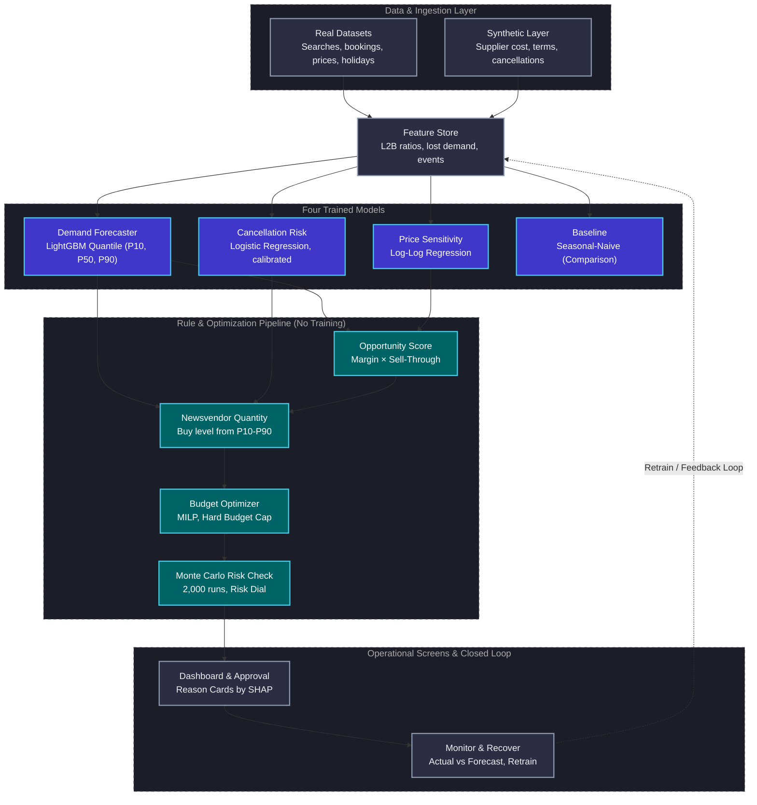

# TBO Intelligent Inventory Procurement & Optimization Platform
## End-to-End Technical Architecture & Implementation Guide

---

## 1. Executive Summary & Problem Context

In travel distribution platforms like **TBO.com**, securing high-demand hotel and travel inventory in advance ("pre-buy" commitments) yields substantially higher margins and guarantees bookable inventory during peak travel periods. However, procuring inventory upfront introduces significant financial exposure:
- **Over-procurement Risk:** Unsold room nights or seats perish immediately at check-in/departure date, resulting in a 100% loss of unrecovered procurement cost.
- **Under-procurement Opportunity Cost:** Stockouts during demand surges lead to lost bookings, customer dissatisfaction, and margin leakage to competitors.
- **Uncertainty & Volatility:** Customer cancellations, macroeconomic shifts, price sensitivity, and seasonal demand swings compound risk.

### Core Objective
Build a decision-support and automated procurement platform that transforms historical travel data, search velocity, and supplier terms into actionable inventory purchase decisions. The system enables TBO.com to **buy the right inventory, at the right time, within an allocated budget cap, maximizing risk-adjusted return on investment (ROI)**.

---

## 2. High-Level System Architecture

The following diagram illustrates the complete end-to-end architecture, matching the system design:



### Architectural Color Legend
- 🟪 **Purple (Trained Models):** Statistical and ML models requiring training pipelines, hyperparameter tuning, and validation splits.
- 🟩 **Green (Rules / Optimizers):** Deterministic algorithms, OR-Tools MILP solver, stochastic Monte Carlo simulations, and Newsvendor formulations (zero model weights to fit).
- ⬛ **Dark Grey (Data & Screens):** Data pipelines, intermediate feature store, interactive dashboards, and operational monitoring interfaces.

---

## 3. Detailed Component Specifications

### 3.1 Data Layer

The platform fuses real travel search and booking datasets with a synthetic business simulation layer to replicate enterprise procurement realities.

| Dataset | Type | Core Attributes | Purpose |
| :--- | :--- | :--- | :--- |
| **Real Searches** | Real | `search_id`, `destination_id`, `hotel_id`, `checkin_date`, `checkout_date`, `rooms`, `guests`, `timestamp` | Measures raw intent and demand momentum before stockouts occur. |
| **Real Bookings** | Real | `booking_id`, `hotel_id`, `booking_timestamp`, `checkin_date`, `selling_price`, `status`, `customer_id` | Ground truth realized demand and conversion patterns. |
| **Historical Prices & Holidays** | Real | `date`, `hotel_id`, `room_category`, `competitor_price`, `is_holiday`, `event_type`, `season_index` | Captures price shifts, holiday calendars (Diwali, Christmas, Eid, school vacations), and festivals. |
| **Supplier Cost & Contract Terms** | Synthetic | `supplier_id`, `contract_tier`, `wholesale_cost`, `minimum_guarantee_qty`, `payment_terms`, `lead_time_days` | Replicates negotiated pre-buy bulk rates vs spot API rates. |
| **Supplier Cancellation Terms** | Synthetic | `refund_window_days`, `penalty_percentage`, `non_refundable_flag` | Defines downside loss equations if pre-bought inventory fails to sell. |

---

### 3.2 Feature Store

Transforms raw streaming and batch data into feature tables indexed by `(hotel_id, destination_id, travel_date, lead_time_bucket)`.

1. **Look-to-Book (L2B) Ratios:**
   $$\text{L2B} = \frac{\sum \text{Searches}}{\sum \text{Bookings} + 1}$$
   - Sudden spikes in L2B with flat bookings indicate supply friction or uncompetitive spot pricing.
   - Low L2B with high bookings signifies high booking conversion velocity.
2. **Lost Demand & Censored Demand Estimation:**
   - When hotel capacity hits 100% or inventory drops to 0, observed booking count truncates.
   - The feature store reconstructs *unconstrained demand* using search volume multiplied by historical baseline conversion rates.
3. **Calendar & Event Features:**
   - Proximity to holidays (days until major regional/national holidays).
   - Day-of-week, week-of-year cyclical encoding: $\sin\left(\frac{2\pi d}{7}\right), \cos\left(\frac{2\pi d}{7}\right)$.
4. **Price Elasticity Context:**
   - Ratio of current wholesale pre-buy rate to market spot rate: $\frac{\text{Cost}_{\text{wholesale}}}{\text{Price}_{\text{market}}}$.

---

### 3.3 Four Trained Models

```
┌────────────────────────────────────────────────────────────────────────┐
│                          FOUR TRAINED MODELS                           │
├──────────────────────────────┬─────────────────────────────────────────┤
│ 1. Demand Forecaster         │ 2. Cancellation Risk                    │
│    - LightGBM Quantile       │    - Calibrated Logistic Regression     │
│    - Predicts P10, P50, P90  │    - Outputs calibrated P(Cancel)       │
├──────────────────────────────┼─────────────────────────────────────────┤
│ 3. Price Sensitivity         │ 4. Baseline Model                       │
│    - Log-Log OLS Regression  │    - Seasonal-Naive Heuristic           │
│    - Elasticity Beta         │    - Benchmarking & Sanity Guardrails   │
└──────────────────────────────┴─────────────────────────────────────────┘
```

#### Model 1: Demand Forecaster (LightGBM Quantile Regression)
- **Objective:** Travel demand is non-normal and heavily right-skewed. Rather than a single point forecast, predicting quantiles provides the exact input required for probabilistic inventory sizing.
- **Quantiles:**
  - **P10 (Pessimistic):** Safe demand floor; 90% probability demand meets or exceeds this level.
  - **P50 (Median):** Expected baseline demand.
  - **P90 (Optimistic):** Bullish upside scenario during surges or major events.
- **Loss Function:** Pinball Loss (Quantile Loss):
  $$\mathcal{L}_q(y, \hat{y}) = \max(q(y - \hat{y}), (1 - q)(\hat{y} - y))$$
- **Features:** Lagged search counts, 7-day rolling bookings, L2B rolling mean, holiday indicator, destination temperature/weather, lead time days.

#### Model 2: Cancellation Risk (Calibrated Logistic Regression)
- **Objective:** Predict the probability $P(\text{Cancellation})$ for future bookings to prevent phantom demand distorting procurement.
- **Architecture:** Logistic regression with L2 regularization, followed by **Platt Scaling** or **Isotonic Regression** to calibrate predicted probabilities.
- **Key Predictors:** Lead time (longer lead times have higher cancellation probability), refundable rate code flag, customer segment (B2B agent vs B2C), star rating, and price differential against average rate.

#### Model 3: Price Sensitivity (Log-Log Regression)
- **Objective:** Quantify the price elasticity of demand ($\epsilon_d$) for each hotel/destination tier.
- **Formulation:**
  $$\ln(\text{Quantity}) = \alpha + \beta \cdot \ln(\text{Price}) + \sum \gamma_j X_j + \varepsilon$$
  - $\beta$ is directly interpreted as the price elasticity:
    $$\epsilon_d = \frac{\partial \ln Q}{\partial \ln P} = \beta$$
- **Usage:** Informs what markup TBO can set on pre-bought rooms without collapsing the sell-through rate.

#### Model 4: Baseline Benchmark (Seasonal-Naive)
- **Objective:** Baseline standard against which ML models are measured.
- **Methodology:** $\hat{y}_t = y_{t - s}$ (Demand from the same day/week of the previous seasonal cycle or preceding 7-day window).
- **Validation Criteria:** ML models must demonstrate $\ge 20\%$ reduction in Pinball Loss and Mean Absolute Error (MAE) compared to baseline to be green-lit for production.

---

### 3.4 Decision & Optimization Pipeline (No Training)

This rule and mathematical optimization suite turns model predictions into deterministic, financially optimal purchase orders.

#### Step 1: Opportunity Score
Filters and ranks thousands of candidate hotel-date combinations:
$$\text{Opportunity Score} = \text{Expected Unit Margin} \times \text{Expected Sell-Through Rate}$$
Where:
- $\text{Expected Unit Margin} = P_{\text{target}} - C_{\text{wholesale}}$
- $\text{Expected Sell-Through Rate} = f(P50, \text{Capacity}, \epsilon_d, P(\text{Cancel}))$

#### Step 2: Newsvendor Quantity Optimization
Applies the classical inventory Newsvendor problem using the predicted demand distribution:
- **Cost of Underage ($C_u$):** Opportunity loss of running out of inventory:
  $$C_u = P_{\text{selling}} - C_{\text{wholesale}}$$
- **Cost of Overage ($C_o$):** Financial loss if a procured room goes unsold (net of any partial salvage/liquidation value $S$):
  $$C_o = C_{\text{wholesale}} - S$$
- **Critical Fractile:**
  $$\text{CF} = \frac{C_u}{C_u + C_o}$$
- **Optimal Purchase Quantity ($Q^*$):**
  $$Q^* = F^{-1}(\text{CF})$$
  Evaluated by interpolating between the LightGBM P10, P50, and P90 quantile predictions.

#### Step 3: Budget Optimizer (Mixed-Integer Linear Programming - MILP)
When capital is constrained by an executive budget cap $B$ (e.g., \$500,000 for a holiday quarter):
- **Decision Variables:**
  - $x_i \in \mathbb{Z}_{\ge 0}$: Number of rooms to pre-buy for hotel-date candidate $i$.
  - $z_i \in \{0, 1\}$: Binary activation flag (if supplier requires a minimum batch size $M_i$).
- **Objective Function:**
  $$\max \sum_{i=1}^{N} \mathbb{E}[\text{Profit}_i(x_i)]$$
- **Subject to Constraints:**
  1. **Hard Budget Cap:**
     $$\sum_{i=1}^{N} C_{\text{wholesale}, i} \cdot x_i \le B$$
  2. **Upper Bound from Newsvendor:**
     $$x_i \le Q_i^*$$
  3. **Supplier Minimum Batch Guarantee:**
     $$M_i \cdot z_i \le x_i \le U_i \cdot z_i, \quad z_i \in \{0, 1\}$$
  4. **Destination Diversification (Risk constraint):**
     $$\sum_{i \in \text{Dest}_k} C_{\text{wholesale}, i} \cdot x_i \le \gamma \cdot B \quad (\text{e.g., no single destination exceeds } 30\% \text{ of budget})$$

#### Step 4: Monte Carlo Risk Check (2,000 Simulation Runs)
Runs 2,000 synthetic market realizations for the selected portfolio:
- Varies demand stochastically around $(P10, P50, P90)$ using a Beta/Log-normal distribution.
- Simulates individual booking cancellations via Bernoulli trials parameterized by $P(\text{Cancel})$.
- Simulates price war / competitor drops.
- **Outputs:**
  - **VaR (Value at Risk, 95% confidence):** Maximum expected loss in the 5% worst-case scenarios.
  - **CVaR (Conditional VaR / Expected Shortfall):** Average loss beyond the 95th percentile.
  - **Calibrated Risk Dial Score (0–100):** Visual gauge of overall portfolio volatility and downside exposure.

---

### 3.5 Dashboard, Explainability & Closed-Loop Operations

#### 1. Explainability via SHAP (SHapley Additive exPlanations)
Procurement managers must not be handed a "black box". Every proposed order comes with an interactive **Reason Card**:
- Example: *"Recommended pre-buy 30 rooms for Hotel Taj Palace (Oct 28–Nov 2)"*
  - **+42%:** Search volume surge (Diwali weekend)
  - **+28%:** Supplier offered 35% discount against historical average spot cost
  - **-15%:** Higher lead-time cancellation historical trend
  - **Net Model Confidence:** High (88%)

#### 2. Procurement Approval Workflow
- Interactive UI where inventory managers can:
  - Approve recommended batch orders with 1-click.
  - Override quantities with live re-calculation of budget impact and Risk Dial.
  - Reject recommendations with feedback tags (e.g., "Supplier dispute", "Renovation scheduled").

#### 3. Monitor & Recover (Closed Loop)
- **Pacing Curve Tracking:** Compares cumulative actual bookings against the forecasted P50 pace curve as the check-in date approaches.
- **Dynamic Recovery Actions:**
  - If booking pace falls below P10 threshold at $T-14$ days: trigger flash sales, bundle with flights, or liquidate to B2B white-label distributors.
- **Retraining Trigger:** Drift detection (PSI > 0.2 on demand features or systematic bias in forecast) automatically updates the feature store and schedules model retraining.

---

## 4. Repository & Directory Structure

```
d:\Coding_local\TBO\
├── client/                     # Frontend Application (React + Vite + Tailwind + shadcn)
│   ├── src/
│   │   ├── components/
│   │   │   ├── dashboard/      # Overview, KPI metrics, portfolio summary
│   │   │   ├── procurement/    # Recommendations table, order approval modal
│   │   │   ├── risk/           # Monte Carlo Risk Dial, VaR charts, distribution curves
│   │   │   ├── explainability/ # SHAP Reason Cards, feature contribution waterfall
│   │   │   └── monitoring/     # Booking pace tracking, actual vs forecast pacing curves
│   │   ├── services/           # API clients connecting to FastAPI server
│   │   └── App.tsx
│   └── package.json
│
├── server/                     # Backend API & Orchestration Service (FastAPI)
│   ├── app/
│   │   ├── api/                # REST endpoints (/recommendations, /optimize, /risk, /pacing)
│   │   ├── core/               # App configuration, settings, database connectors
│   │   ├── optimization/       # MILP solver (PuLP/SciPy), Newsvendor engine, Monte Carlo runner
│   │   └── schemas/            # Pydantic request/response data contracts
│   ├── requirements.txt
│   └── main.py
│
├── models/                     # Machine Learning Pipelines & Feature Engineering
│   ├── data/                   # Data generation scripts & sample storage
│   │   ├── real/               # Search logs, booking logs, holiday calendar
│   │   └── synthetic/          # Supplier contracts, cancellation policies generator
│   ├── feature_store/          # Transformations (L2B, censored demand, cyclical features)
│   ├── training/               # Model training scripts
│   │   ├── train_demand.py     # LightGBM Quantile (P10, P50, P90)
│   │   ├── train_cancel.py     # Calibrated Logistic Regression
│   │   ├── train_elasticity.py # Log-Log Price Sensitivity OLS
│   │   └── baseline.py         # Seasonal-Naive benchmark
│   ├── explainability/         # SHAP tree explainer scripts & card generators
│   └── artifacts/              # Serialized model weights (.joblib, .booster)
│
├── problem_statement/          # Hackathon PDF and challenge specifications
│   └── Automate Inventory Optimization.pdf
│
└── GUIDE.md                    # This architecture and operational blueprint
```

---

## 5. Technology Stack Summary

| Subsystem | Technology Choice | Justification |
| :--- | :--- | :--- |
| **Core Models** | Python 3.11, LightGBM, Scikit-learn, Statsmodels | Fast quantile regression, native tree SHAP support, robust probability calibration. |
| **Optimization** | PuLP / SciPy Optimization / NumPy | Industrial-standard Mixed-Integer Linear Programming with deterministic solvers. |
| **Simulation** | NumPy Vectorized Monte Carlo | Capable of executing 2,000 portfolio simulations across hundreds of items in < 500ms. |
| **Backend API** | FastAPI, Pydantic, Uvicorn | High-throughput asynchronous endpoints with auto-generated OpenAPI documentation. |
| **Frontend** | React, Vite, Tailwind CSS, Lucide Icons, Recharts | Responsive, clean executive dashboard with interactive risk gauges and pacing visualizers. |

---

## 6. Implementation Roadmap & Execution Phases

### Phase 1: Data Synthesis & Feature Store Pipeline
- [ ] Implement synthetic supplier contract generator (`wholesale_cost`, `minimum_batch`, `refund_penalty`).
- [ ] Generate synthetic search and booking datasets reflecting realistic holiday surges and stockout truncation.
- [ ] Build Feature Store pipeline computing Look-to-Book (L2B), calendar encodings, and estimated lost demand.

### Phase 2: Four ML Models & Baseline Implementation
- [ ] Implement Seasonal-Naive baseline to establish performance floor.
- [ ] Train LightGBM Quantile Regressors for P10, P50, and P90 demand bands; compute Pinball Loss.
- [ ] Train and calibrate Logistic Regression for cancellation probability; verify calibration curve (Brier Score).
- [ ] Fit Log-Log price sensitivity regression to extract hotel-tier elasticity curves.

### Phase 3: Decision Engine & Optimization Module
- [ ] Code Opportunity Score calculation ($\text{Margin} \times \text{Sell-Through}$).
- [ ] Implement Newsvendor critical fractile quantity calculator mapping to P10–P90 quantiles.
- [ ] Build MILP Budget Optimizer using PuLP to enforce hard budget caps and supplier batch thresholds.
- [ ] Build 2,000-run Monte Carlo simulation engine and calibrate the 0–100 Risk Dial with VaR 95%.

### Phase 4: Explainability & FastAPI Backend Service
- [ ] Integrate SHAP TreeExplainer on LightGBM models to generate feature attribution reason cards.
- [ ] Build FastAPI server with endpoints:
  - `POST /api/v1/optimize`: Accepts budget & destination filters, returns optimal buy portfolio.
  - `POST /api/v1/simulate-risk`: Runs Monte Carlo simulation on custom or overridden quantities.
  - `GET /api/v1/reasons/{item_id}`: Returns SHAP breakdown for a candidate hotel.
  - `GET /api/v1/pacing/{item_id}`: Returns real-time pacing curves (actual vs forecast).

### Phase 5: Interactive Executive Dashboard
- [ ] Build React frontend with tabbed workflow:
  1. **Procurement Recommendations:** Interactive table with MILP recommended quantities, unit costs, expected margins, and SHAP cards.
  2. **Budget & Risk Control Center:** Sliders for budget cap and Risk Dial with VaR / CVaR charts.
  3. **Monitor & Recover Pacing:** Real-time tracking curves with automated markdown alert triggers.

---

## 7. Compliance & Rules Reminder
- **Git Push / Commit Rule:** Strictly do not run `git push` or `git commit` until explicitly requested by the user.
