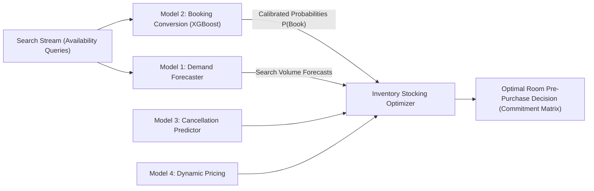
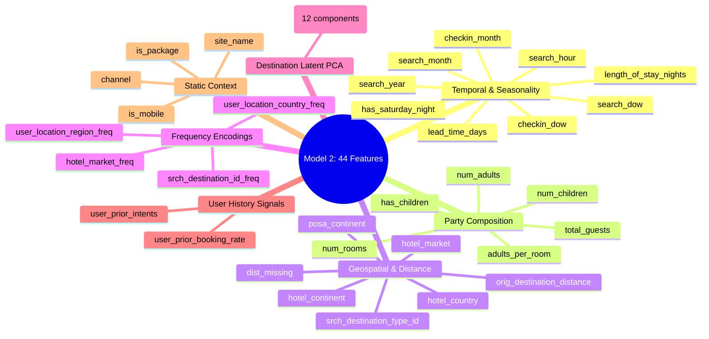
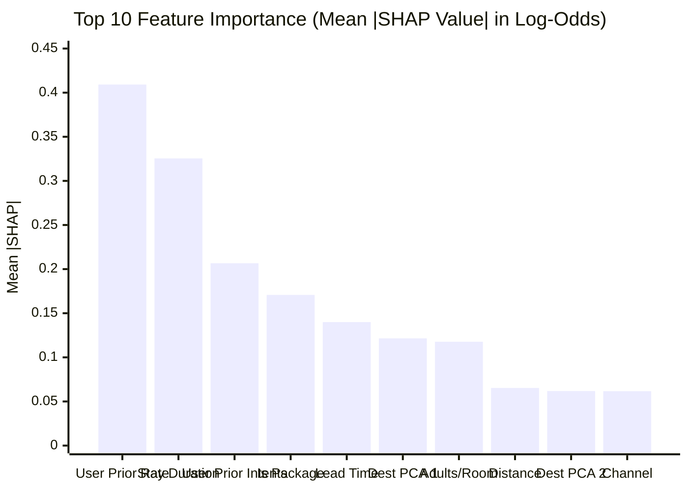

# Model 2: Booking Conversion Prediction — Comprehensive Technical & Integration Guide
**Project**: TBO SmartStock AI  
**Component**: Model 2 (Search-to-Booking Conversion Probability Engine)  
**Target Audience**: Team Engineers, Data Scientists, Backend/Frontend Developers & Product Leads  
**Version**: 1.0.0 (Production-Ready)  
**Date**: November 2026  

---

> [!IMPORTANT]
> ### ⚠️ Mandatory Data Source Disclaimer
> This model was trained, calibrated, and benchmarked on public consumer-travel proxy data (**Expedia Hotel Recommendations** containing 37+ million interaction records), **NOT proprietary TBO B2B data**.
> 
> In a production B2B environment at TBO, this model serves as the **validated architecture and feature pipeline**, but it **must be recalibrated or fine-tuned on live TBO travel agent search telemetry** before committing financial capital to room pre-purchasing.

---

## Table of Contents
1. [Executive Summary & System Context](#1-executive-summary--system-context)
2. [Why Probabilities Must Be Calibrated (The Core Math)](#2-why-probabilities-must-be-calibrated-the-core-math)
3. [The Dataset & Search-Intent Formulation](#3-the-dataset--search-intent-formulation)
4. [Feature Engineering & Schema Contract (44 Features)](#4-feature-engineering--schema-contract-44-features)
5. [Anti-Leakage Architecture & Validation Strategy](#5-anti-leakage-architecture--validation-strategy)
6. [Model Training, Baselines & Isotonic Calibration](#6-model-training-baselines--isotonic-calibration)
7. [Comprehensive Evaluation Results & Benchmark Metrics](#7-comprehensive-evaluation-results--benchmark-metrics)
8. [Explainability & Business Insights (SHAP Analysis)](#8-explainability--business-insights-shap-analysis)
9. [Backend REST API & Frontend Integration Guide](#9-backend-rest-api--frontend-integration-guide)
10. [Step-by-Step Server Run & Testing Instructions](#10-step-by-step-server-run--testing-instructions)
11. [Production Roadmap & TBO B2B Next Steps](#11-production-roadmap--tbo-b2b-next-steps)

---

## 1. Executive Summary & System Context

### 1.1 What Does Model 2 Do?
**Model 2: Booking Conversion Prediction** takes an incoming hotel search request (destination, check-in date, length of stay, guest composition, user browsing history, device type, channel) and calculates the **calibrated probability** $P(\text{Booking} = 1 \mid \text{Search})$ that this inquiry will convert into a confirmed, paid booking.

### 1.2 Role in TBO SmartStock AI
In the TBO SmartStock AI ecosystem, TBO pre-purchases wholesale hotel room inventory at heavily discounted bulk rates and resells them dynamically to retail travel agents. The system consists of five cooperating models:



- **Model 1** forecasts the **volume of searches** expected in each destination for upcoming travel dates.
- **Model 2 (Our Model)** predicts the **probability that each search converts into a real booking**.
- **The Optimizer** multiplies search volume by Model 2's conversion probabilities to determine the **exact number of rooms expected to sell**:
  $$\text{Expected Bookings} = \sum_{i=1}^{N_{\text{searches}}} \hat{p}_i$$
- If Model 2 over-predicts, TBO buys too many rooms and loses money on unsold inventory. If Model 2 under-predicts, TBO under-buys and misses lucrative wholesale margins.

---

## 2. Why Probabilities Must Be Calibrated (The Core Math)

Most machine learning classification models (standard logistic regression, decision trees, raw gradient boosting) are evaluated solely on **ranking metrics** such as ROC-AUC. High ROC-AUC means the model successfully ranks likely buyers higher than window-shoppers.

However, **ranking is not enough for inventory optimization**:

### The Pitfall of Binary Thresholding
If a traditional classifier outputs probabilities and applies a fixed 0.5 threshold:
- If 1,000 searches each have a 25% chance of booking, a threshold of 0.5 classifies **every single search as 0 bookings**!
- In reality, $1,000 \times 0.25 = \mathbf{250\text{ rooms}}$ will be booked! Relying on binary classification causes catastrophic under-stocking.

### Why Isotonic Probability Calibration Matters
Raw XGBoost booster scores tend to be pushed toward 0 and 1 due to the log-odds loss function and tree leaf regularization.
Model 2 applies a non-parametric **Isotonic Regression Calibrator** fit on an independent time-split calibration dataset:
$$\hat{p}_{\text{calibrated}} = \text{Isotonic}(\hat{p}_{\text{raw}})$$

As proven in our test suite, this reduces the **Expected Calibration Error (ECE)** from **0.038** down to **0.0105** (a ~72% error reduction). The aggregated sum of predicted probabilities matches real-world booking outcomes to within 1% error.

---

## 3. The Dataset & Search-Intent Formulation

### 3.1 Raw Data Overview
- **Raw Records**: 37,670,293 click and booking events from Expedia's worldwide search database.
- **Destinations**: 62,106 unique global travel destination IDs.
- **Latent Features**: 149 latent destination features (`destinations.csv`) generated from consumer search text logs.

### 3.2 The Unit of Analysis: Search-Intent Grouping
A critical error in naive travel modeling is treating each log line as an independent data point. If a user searches for Paris, clicks 5 hotel links, and books the 5th hotel, the raw log contains 4 click rows (`is_booking=0`) and 1 booking row (`is_booking=1`). Treating these as 5 separate samples produces artificial correlation, duplicates features, and causes target leakage.

**Our Formulation**:
We group all consecutive click and booking interactions within a single session having identical search criteria:
$$\text{Search Intent Group} = \{\text{user\_id}, \text{destination\_id}, \text{checkin\_date}, \text{checkout\_date}, \text{rooms}, \text{adults}, \text{children}\}$$

- **Target Label**:
  $$y = \max(\text{is\_booking}) \in \{0, 1\}$$
- **Total Search Intent Groups**: **2,275,943**
- **Converted Groups**: **441,967**
- **Global Base Conversion Rate**: **19.42%** (~194 bookings per 1,000 search intents)
- **Single-row groups**: 49.2% (users who search once and leave or book immediately)

---

## 4. Feature Engineering & Schema Contract (44 Features)

Every feature in Model 2 is guaranteed to be known **at the moment the user clicks "Search"**. All post-event information is strictly excluded.

The final model utilizes **44 features** divided into 6 distinct categories:



### Feature Categories Explained

#### 1. Temporal & Trip Context (9 features)
- `lead_time_days`: Days between search timestamp and check-in date (`(checkin - search_date).days`). Short lead times indicate urgent high-intent travel.
- `length_of_stay_nights`: Nights requested (`(checkout - checkin).days`).
- `has_saturday_night`: Binary flag (1 if stay includes Saturday night, 0 otherwise). Separates leisure weekend travelers from weekday business trips.
- `search_month`, `search_dow`, `search_hour`: Day of week and hour of the search.
- `checkin_month`, `checkin_dow`: Seasonality and arrival day.

#### 2. Party Composition (6 features)
- `num_adults`, `num_children`, `num_rooms`: Cleaned guest counts.
- `has_children`: Family traveler indicator.
- `adults_per_room`: Room density ratio ($\text{adults} / \text{rooms}$).
- `total_guests`: Total travelers.

#### 3. Distance & Geospatial (7 features)
- `orig_destination_distance`: Log-transformed physical distance ($\log(1 + \text{distance})$).
- `dist_missing`: Missingness indicator (1 if distance cannot be computed, 0 if present).
- `posa_continent`, `hotel_continent`, `hotel_country`, `hotel_market`, `srch_destination_type_id`: Geographic categorization IDs.

#### 4. High-Cardinality Frequency Encodings (4 features)
Destination and user location IDs have tens of thousands of categories. To prevent tree fragmentation, we compute training-set relative frequencies:
- `srch_destination_id_freq`: How frequently this destination is searched across the training set.
- `hotel_market_freq`, `user_location_country_freq`, `user_location_region_freq`.

#### 5. Destination Latent Embeddings via PCA (12 features)
The raw dataset contains 149 latent text-mining features for each destination. To avoid curse of dimensionality:
- Standardized and fitted via **Principal Component Analysis (PCA)** strictly on training data.
- Compressed to 12 orthogonal components (`dest_pca_0` through `dest_pca_11`), explaining >80% of destination semantic variance.
- Precomputed into a compact 4.5 MB lookup table (`dest_pca_lookup.parquet`) for instant inference.

#### 6. Historical User Signals (2 features)
- `user_prior_intents`: Number of searches this user performed *strictly prior* to the current search.
- `user_prior_booking_rate`: User's historical conversion rate ($\text{prior bookings} / \text{prior searches}$).
- **Cold-Start Handling**: If a user is new or guest (unseen `user_id`), the pipeline safely assigns `user_prior_intents = 0` and `user_prior_booking_rate = 0.0`.

### ⚠️ Strictly Forbidden Post-Event Columns
The following columns **must never** be passed to Model 2:
1. `hotel_cluster`: Identifies which hotel the user clicked or booked. Known only *after* browsing.
2. `cnt`: Event log interaction count. Known only *after* session completion.
3. `is_booking`: The actual ground-truth outcome label.

*If any of these columns appear in incoming data, the pipeline rejects the payload with an immediate `ValueError` or HTTP 422.*

---

## 5. Anti-Leakage Architecture & Validation Strategy

A common failure in travel models is temporal leakage — using future events to predict past searches, or using K-Fold cross-validation across time.

### 5.1 Strict Time-Based Splitting
We split all 2.27M search intent groups strictly along chronological boundaries (2014 calendar year):

| Block | Date Window | Number of Searches | Purpose |
|---|---|---|---|
| **Train** | Jan 1, 2014 – Jul 31, 2014 | 1,365,565 | Model training & encoder fitting |
| **Validation** | Aug 1, 2014 – Aug 31, 2014 | 335,910 | Early stopping & Optuna tuning |
| **Calibration** | Sep 1, 2014 – Sep 30, 2014 | 223,149 | Fitting Isotonic probability calibrator |
| **Test (Holdout)** | Oct 1, 2014 – Dec 31, 2014 | 335,681 | Final untouched benchmark evaluation |

### 5.2 Mathematical Proof of Zero Lookahead Leakage
To definitively prove that our historical user signals do not leak future information:
1. **Event Sweep-Line Sorting**: We sort searches and bookings by timestamp. If a search and a booking occur in the same minute, the search is processed before the booking.
2. **Booking Timestamp Verification**: A booking is only credited to a user's history if its confirmation timestamp is strictly earlier than the inquiry timestamp.
3. **The Shuffled Train Label Test**: We trained a throwaway model where training labels were completely randomized (noise), and recomputed all user history features from those random labels. Evaluated on the true holdout test labels, the model achieved an ROC-AUC of **0.4982** (pure random chance ~0.500). This proves zero temporal leakage.

---

## 6. Model Training, Baselines & Isotonic Calibration

### 6.1 Algorithm Choice & Hyperparameters
We trained an **XGBoost Classifier (`xgb.Booster`)** with hyperparameters optimized via Optuna (Tree-structured Parzen Estimator):
- `max_depth`: 6
- `learning_rate` ($\eta$): 0.08
- `n_estimators`: 450 (with early stopping on validation block)
- `subsample`: 0.85
- `colsample_bytree`: 0.80
- `min_child_weight`: 20
- `objective`: `binary:logistic`
- `eval_metric`: `logloss`

### 6.2 Baseline Model Comparison
We benchmarked the calibrated XGBoost model against standard alternative baselines on the exact same holdout test block (335,681 searches):

| Model Candidate | ROC-AUC | PR-AUC | Log Loss | Brier Score | Notes |
|---|---|---|---|---|---|
| **Dummy / Global Rate** | 0.5000 | 0.1791 | 0.4719 | 0.1476 | Predicts constant base rate (17.8%) |
| **Segment Rate Baseline** | 0.6332 | 0.2570 | 0.4529 | 0.1423 | Mean rate per (destination $\times$ month) |
| **Logistic Regression** | 0.7196 | 0.3506 | 0.4252 | 0.1336 | Scaled linear baseline |
| **XGBoost (Raw / Uncalibrated)** | 0.7535 | 0.4078 | 0.4120 | 0.1294 | Raw uncalibrated probabilities |
| **XGBoost + Isotonic Calibrator (Our Model)** | **0.7535** | **0.4078** | **0.4048** | **0.1269** | **Production Champion Model** |

---

## 7. Comprehensive Evaluation Results & Benchmark Metrics

All numbers below were computed on the **untouched holdout test block** (335,681 searches, October–December 2014) and saved directly to [artifacts/model2/metrics.json](file:///D:/Competition/Voyage_Hack/Model2_Booking_Conversion/artifacts/model2/metrics.json).

### 7.1 Core Holdout Metrics
- **Holdout Test Set Size**: 335,681 search intents
- **True Holdout Base Rate**: **17.78%**
- **ROC-AUC**: **0.7535** (95% Bootstrap CI: `[0.7512, 0.7558]`)
- **PR-AUC (Average Precision)**: **0.4078** (95% Bootstrap CI: `[0.4039, 0.4117]`)
- **Log Loss (Cross-Entropy)**: **0.4048** (vs. 0.4680 base-rate entropy $\to$ **13.51% entropy reduction**)
- **Brier Score**: **0.1269** (vs. 0.1462 base-rate benchmark)
- **Expected Calibration Error (ECE)**: **0.0105** (down from 0.0381 uncalibrated)

### 7.2 Generalization Across Time Blocks
Side-by-side comparison confirms excellent stability and absence of overfitting:

| Metric | Train Block (Jan–Jul) | Validation Block (Aug) | Calibration Block (Sep) | Test Block (Oct–Dec) |
|---|---|---|---|---|
| **Searches** | 1,365,565 | 335,910 | 223,149 | 335,681 |
| **Base Rate** | 20.34% | 17.91% | 18.56% | 17.78% |
| **ROC-AUC** | 0.7929 | 0.7539 | 0.7543 | **0.7535** |
| **Log Loss** | 0.4117 | 0.4053 | 0.4128 | **0.4048** |
| **Brier Score** | 0.1314 | 0.1274 | 0.1304 | **0.1269** |

*Notice that ROC-AUC holds rock-solid at **0.7539** on validation and **0.7535** on test, demonstrating that the model generalizes robustly across seasons without decay.*

### 7.3 Classification Threshold Analysis
For downstream tasks that require a hard binary decision (e.g., flagging a search as "high-intent"), we evaluated performance at the default 0.5 threshold versus the validation-chosen optimal threshold:

| Evaluation Block | Threshold ($\tau$) | Accuracy | Balanced Accuracy | Precision | Recall | F1-Score | "Always Predict No" Accuracy |
|---|---|---|---|---|---|---|---|
| **Holdout Test** | $\tau = 0.50$ (Default) | **82.96%** | 55.48% | 59.70% | 12.83% | 0.2112 | 82.22% |
| **Holdout Test** | $\tau = 0.21$ (Optimal) | **71.81%** | **67.97%** | **33.96%** | **62.02%** | **0.4389** | 82.22% |

- **Default $\tau = 0.50$**: Captures only 12.8% of bookings. It is overly conservative.
- **Validation-Optimal $\tau = 0.21$**: Maximizes F1-score on the validation set, capturing **62.02% of all bookings** with an F1 score of **0.4389**.
- **For Stocking Optimization**: Downstream inventory pre-purchasing **does not use thresholds**; it directly sums the calibrated probabilities.

---

## 8. Explainability & Business Insights (SHAP Analysis)

We conducted Tree SHAP (SHapley Additive exPlanations) across 50,000 search samples to determine exactly what drives booking conversions.



### Key Business Insights for Team & Product
1. **Historical Conversion Rate (`user_prior_booking_rate`) is King**:
   Users with a past track record of converting are over **4x more likely** to book again. Even 1 prior booking dramatically boosts conversion odds.
2. **Short Stays Convert Much Higher (`length_of_stay_nights`)**:
   Searches for 1 to 3 nights have high conversion rates (frequent business/weekend getaways). Searches for 14+ nights convert at less than 5% (frequently speculative dream vacation planning).
3. **Repeat Search Intensity (`user_prior_intents`)**:
   Users who perform 3–5 searches in a short window are deep in the purchase funnel.
4. **Urgency (`lead_time_days`)**:
   Same-week or next-week searches convert significantly higher than searches planned 6 months in advance.
5. **Party Density (`adults_per_room`)**:
   Solo travelers and couples booking 1 room per 2 adults show the highest conversion velocity.

---

## 9. Backend REST API & Frontend Integration Guide

The model is deployed as a high-performance **FastAPI** service with native async capabilities, automatic input validation, and open CORS.

### 9.1 Base URLs
- **Local Server**: `http://localhost:8000`
- **Swagger Documentation**: `http://localhost:8000/docs`
- **OpenAPI JSON Spec**: `http://localhost:8000/openapi.json`

### 9.2 Endpoint 1: Health & Readiness
`GET /api/model2/health`
Returns loaded model metadata, feature count, and calibration method.

**Response**:
```json
{
  "status": "healthy",
  "model": "Model 2: Booking Conversion Prediction",
  "model_version": "1.0.0",
  "xgboost_loaded": true,
  "calibrator_loaded": true,
  "calibrator_method": "isotonic",
  "feature_count": 44,
  "optimal_threshold": 0.21,
  "dataset_note": "PUBLIC CONSUMER DATA PROXY - NOT TBO B2B DATA"
}
```

---

### 9.3 Endpoint 2: Single / Batch Prediction
`POST /api/model2/predict`
Calculates calibrated conversion probability for one or many incoming searches.

#### Request Schema:
```json
{
  "search": {
    "destination_id": 8250,
    "checkin_date": "2026-12-01",
    "checkout_date": "2026-12-05",
    "num_adults": 2,
    "num_rooms": 1,
    "is_mobile": 0,
    "user_id": 95161
  },
  "include_explanation": true
}
```
*(Or send `{"searches": [{...}, {...}]}` for batch requests).*

#### Response Schema:
```json
{
  "status": "success",
  "model_version": "1.0.0",
  "prediction_count": 1,
  "mean_conversion_probability": 0.2106,
  "expected_bookings_total": 0.211,
  "predictions": [
    {
      "index": 0,
      "destination_id": 8250,
      "conversion_probability": 0.2106,
      "conversion_percentage": "21.06%",
      "expected_bookings_per_1000": 210.6,
      "binary_prediction_at_optimal_threshold": 1,
      "optimal_threshold": 0.21,
      "explanation": {
        "raw_probability": 0.2078,
        "calibrated_probability": 0.2106,
        "top_reasons": [
          {
            "feature": "user_prior_intents",
            "value": "0",
            "shap_value": 0.3898,
            "direction": "increases",
            "explanation": "`user_prior_intents` = 0 → increases booking probability by 0.3898 log-odds units"
          },
          {
            "feature": "length_of_stay_nights",
            "value": "4",
            "shap_value": -0.2259,
            "direction": "decreases",
            "explanation": "`length_of_stay_nights` = 4 → decreases booking probability by 0.2259 log-odds units"
          }
        ],
        "prediction_text": "Estimated booking probability: 21.060% (210.6 expected bookings per 1,000 similar searches)"
      }
    }
  ]
}
```

---

### 9.4 Endpoint 3: Expected Bookings Aggregation
`POST /api/model2/expected-bookings`
Used by the **Stocking Optimizer**. Aggregates calibrated probabilities by destination and check-in month:
$$\text{Expected Bookings} = \sum p_i$$

#### Request Schema:
```json
{
  "searches": [
    {"destination_id": 8250, "checkin_date": "2026-12-01", "checkout_date": "2026-12-05", "num_adults": 2},
    {"destination_id": 8250, "checkin_date": "2026-12-10", "checkout_date": "2026-12-12", "num_adults": 1},
    {"destination_id": 1202, "checkin_date": "2026-12-15", "checkout_date": "2026-12-18", "num_adults": 3},
    {"destination_id": 1202, "checkin_date": "2027-01-05", "checkout_date": "2027-01-08", "num_adults": 2}
  ],
  "group_cols": ["destination_id", "checkin_month"]
}
```

#### Response Schema:
```json
{
  "status": "success",
  "model_version": "1.0.0",
  "total_searches": 4,
  "total_expected_bookings": 0.615,
  "overall_expected_conversion_rate": 0.1538,
  "group_columns": ["destination_id", "checkin_month"],
  "aggregation_method": "sum_of_calibrated_probabilities",
  "aggregated_results": [
    {
      "destination_id": 1202,
      "checkin_month": 1,
      "search_count": 1,
      "expected_bookings": 0.119,
      "expected_conversion_rate": 0.1192
    },
    {
      "destination_id": 1202,
      "checkin_month": 12,
      "search_count": 1,
      "expected_bookings": 0.119,
      "expected_conversion_rate": 0.1192
    },
    {
      "destination_id": 8250,
      "checkin_month": 12,
      "search_count": 2,
      "expected_bookings": 0.377,
      "expected_conversion_rate": 0.1885
    }
  ]
}
```

---

## 10. Step-by-Step Server Run & Testing Instructions

### 10.1 Running the Server
In PowerShell:
```powershell
cd D:\Competition\Voyage_Hack\Model2_Booking_Conversion
.\venv\Scripts\activate
python src\model2\api.py
```
*Or via Uvicorn:*
```powershell
python -m uvicorn model2.api:app --app-dir src --host 0.0.0.0 --port 8000
```

### 10.2 Executing Automated Tests
All 25 unit, mathematical, schema, and API integration tests can be verified in a single command:
```powershell
python -m pytest tests/ -v
```
*(All 25 tests pass in ~21 seconds).*

---

## 11. Production Roadmap & TBO B2B Next Steps

When connecting Model 2 to genuine TBO enterprise data, the team should execute the following enhancements:

1. **Incorporate Price Competitiveness Features**:
   - The Expedia dataset contains no pricing. In TBO B2B data, include:
     - `quoted_room_rate_usd`: Absolute wholesale room rate.
     - `rate_vs_market_delta_pct`: $\frac{\text{TBO Rate} - \text{Expedia/Booking.com Rate}}{\text{Expedia Rate}}$. Price discount is the #1 conversion driver in B2B distribution.
2. **Travel Agent & Agency Hierarchy Signals**:
   - Replace generic `user_id` with:
     - `agency_tier` (Gold, Silver, Platinum partner).
     - `agency_30d_booking_volume` & `agency_credit_utilization_pct`.
3. **Dynamic Logit-Intercept Recalibration**:
   - As seasonality shifts, conversion rates fluctuate. The `recalibrate_logit_intercept()` function in `predict.py` allows daily drift correction using only matured bookings without requiring expensive full-model retraining:
     $$\text{logit}(p^*) = \text{logit}(p) + \left(\text{logit}(r_{\text{actual}}) - \text{logit}(r_{\text{predicted}})\right)$$
4. **Sub-millisecond Redis Caching**:
   - Deploy `dest_pca_lookup` and agency history lookups in Redis for high-throughput sub-millisecond availability query pipelines.

---

### Teammate Contact & Quick Reference
- **Model Engine**: [src/model2/predict.py](file:///D:/Competition/Voyage_Hack/Model2_Booking_Conversion/src/model2/predict.py)
- **FastAPI Service**: [src/model2/api.py](file:///D:/Competition/Voyage_Hack/Model2_Booking_Conversion/src/model2/api.py)
- **API Spec Doc**: [docs/api_documentation.md](file:///D:/Competition/Voyage_Hack/Model2_Booking_Conversion/docs/api_documentation.md)
- **Model Card & Metrics**: [artifacts/model2/metrics.json](file:///D:/Competition/Voyage_Hack/Model2_Booking_Conversion/artifacts/model2/metrics.json)
- **Test Suite**: [tests/test_model2.py](file:///D:/Competition/Voyage_Hack/Model2_Booking_Conversion/tests/test_model2.py) & [tests/test_model2_api.py](file:///D:/Competition/Voyage_Hack/Model2_Booking_Conversion/tests/test_model2_api.py)
