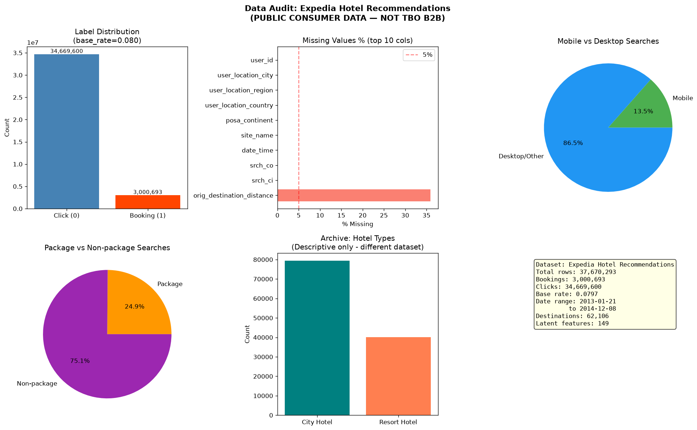

# Data Audit Report

> **IMPORTANT: Both datasets are PUBLIC CONSUMER-TRAVEL PROXY DATA, NOT TBO B2B data.**
> Results are for demonstration purposes only. Calibration will shift on real TBO traffic.

Generated: 2026-11-18T18:12:35.245758

## Dataset Identification

| Folder | Dataset | Usage |
|--------|---------|-------|
| `expedia-hotel-recommendations/` | Expedia Hotel Recommendations (Kaggle 2016) | **PRIMARY** — model training |
| `archive/hotel_bookings.csv` | Hotel Booking Demand (Antonio et al. 2019) | Descriptive appendix only |

## Primary Dataset: Expedia Hotel Recommendations

**File**: `D:\Competition\Voyage_Hack\Datasets\Datasets_Model2\expedia-hotel-recommendations\train.csv`

| Metric | Value |
|--------|-------|
| Total rows | 37,670,293 |
| Bookings (is_booking=1) | 3,000,693 |
| Clicks (is_booking=0) | 34,669,600 |
| **Base rate (booking%)** | **0.0797 (7.97%)** |
| Mobile searches | 13.5% |
| Package searches | 24.9% |
| Date range (approx) | 2013-01-21 to 2014-12-08 |

### Columns

| Column | Dtype | Missing% |
|--------|-------|----------|
| date_time | str | 0.00% |
| site_name | int64 | 0.00% |
| posa_continent | int64 | 0.00% |
| user_location_country | int64 | 0.00% |
| user_location_region | int64 | 0.00% |
| user_location_city | int64 | 0.00% |
| orig_destination_distance | float64 | 35.90% |
| user_id | int64 | 0.00% |
| is_mobile | int64 | 0.00% |
| is_package | int64 | 0.00% |
| channel | int64 | 0.00% |
| srch_ci | str | 0.12% |
| srch_co | str | 0.12% |
| srch_adults_cnt | int64 | 0.00% |
| srch_children_cnt | int64 | 0.00% |
| srch_rm_cnt | int64 | 0.00% |
| srch_destination_id | int64 | 0.00% |
| srch_destination_type_id | int64 | 0.00% |
| is_booking | int64 | 0.00% |
| cnt | int64 | 0.00% |
| hotel_continent | int64 | 0.00% |
| hotel_country | int64 | 0.00% |
| hotel_market | int64 | 0.00% |
| hotel_cluster | int64 | 0.00% |

### Destinations.csv

- Rows: 62,106
- Columns: 150
- Latent features: 149 (d1..d149)

## Secondary Dataset: Hotel Booking Demand (Descriptive Only)

**File**: `D:\Competition\Voyage_Hack\Datasets\Datasets_Model2\archive\hotel_bookings.csv`

| Metric | Value |
|--------|-------|
| Total rows | 119,390 |
| Cancellation rate | 0.3704 |
| Year range | 2015-2017 |

**Note**: This dataset has `is_canceled`, not `is_booking`. It is NOT pooled with Expedia. Used for supplementary descriptive patterns only.

## Charts

## Key Findings

1. Expedia base rate is **7.97%** (~80 bookings per 1,000 searches).
2. `orig_destination_distance` has 35.9% missing — will add missing indicator.
3. `hotel_cluster` will be EXCLUDED (post-event information).
4. `cnt` will be EXCLUDED (post-event count of events in group).
5. Destinations.csv provides 149 latent features → PCA to 12 components.
